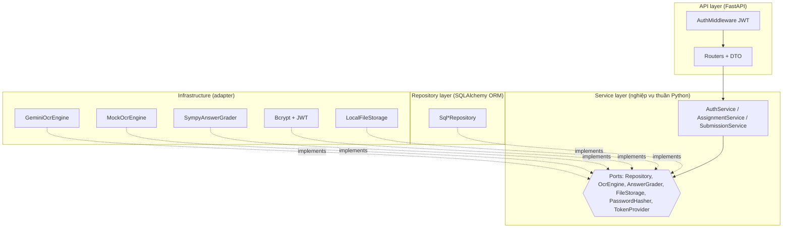

# Math Grader API

Dịch vụ backend chấm bài tập toán từ **ảnh chụp bài làm của học sinh**. Ảnh được nhận dạng bằng **Gemini API**, đáp án cuối cùng được so với đáp án chuẩn bằng **SymPy** (kiểm tra tương đương biểu thức, ví dụ `2x+4` ≡ `2(x+2)`).

> Đồ án môn Kiến trúc phần mềm - Pha 1.

## 1. Nghiệp vụ
Giáo viên tạo **bài tập** (đề + đáp án chuẩn). Học sinh **nộp ảnh bài làm**; hệ thống OCR, trích đáp án cuối, chấm điểm (thang 10) và lưu kết quả.

Thực thể: `User`, `Assignment`, `Submission` (chứa kết quả chấm).

## 2. Kiến trúc phân tầng



**Luật phụ thuộc:** `api → service ← repository/infrastructure`. Tầng `service` và `domain` **không import** FastAPI, SQLAlchemy hay SDK Gemini; chúng chỉ biết các interface trong `service/ports.py` (đảo ngược phụ thuộc). `api/container.py` là nơi duy nhất ghép interface với cài đặt cụ thể.

```
app/
  domain/          # dataclass thực thể
  service/         # nghiệp vụ + ports.py (interface) + errors.py
  repository/      # ORM + cài đặt Repository
  infrastructure/  # Gemini, Mock OCR, SymPy, bcrypt/JWT, lưu file
  api/             # FastAPI: routers, schemas, middleware, container
```

## 3. Đặc tả API (Swagger tại `/docs`)

| Method | Endpoint | Auth | Mô tả |
|---|---|---|---|
| POST | `/auth/register` | ✗ | Đăng ký |
| POST | `/auth/login` | ✗ | Đăng nhập, trả JWT |
| POST | `/assignments` | ✓ | Tạo bài tập |
| GET | `/assignments`, `/assignments/{id}` | ✗ | Xem bài tập |
| POST | `/submissions` | ✓ | Upload ảnh (multipart: `assignment_id`, `file`) → OCR → chấm |
| GET | `/submissions`, `/submissions/{id}` | ✓ | Xem lịch sử / kết quả (chỉ của chính mình) |
| DELETE | `/submissions/{id}` | ✓ | Xóa bài nộp |

## 4. Bảo mật
- Mật khẩu băm bằng **bcrypt**; đăng nhập trả **JWT (HS256)**.
- Xác thực nằm ở **một middleware** (`api/middleware.py`) với danh sách đường dẫn công khai; endpoint không tự kiểm tra token.

## 5. Chạy dự án

Lấy Gemini API key tại https://aistudio.google.com/apikey.

**Docker (app + PostgreSQL):**
```bash
cp .env.example .env      # điền GEMINI_API_KEY
docker compose --env-file .env up --build
# mở http://localhost:8000/docs
```
Chạy không cần key: `OCR_ENGINE=mock docker compose up --build`.

**Chạy local (SQLite):**
```bash
pip install -r requirements-dev.txt
export GEMINI_API_KEY=...        # hoặc OCR_ENGINE=mock
uvicorn app.api.main:app_factory --factory --reload
pytest
```
Dùng Swagger: gọi `/auth/login` → bấm **Authorize** → dán token.

## 6. Kiểm thử tải (Kaggle CPU)
Kaggle thường không có Docker, nên chạy uvicorn trực tiếp trong notebook:
```bash
!pip install -r requirements-dev.txt
!OCR_ENGINE=mock nohup uvicorn app.api.main:app_factory --factory --port 8000 --workers 2 &
!locust -f loadtest/locustfile.py --headless -u 50 -r 10 -t 60s --host http://localhost:8000 --csv=baseline
```
Dùng `OCR_ENGINE=mock` để đo kiến trúc thay vì độ trễ của Gemini. Kết quả baseline (RPS, p50/p95, tỉ lệ lỗi) ghi vào bảng dưới đây:

| Endpoint | RPS | p50 | p95 | Lỗi |
|---|---|---|---|---|
| _(điền sau khi chạy)_ | | | | |

## 7. Thành viên và phân công
_(điền)_
